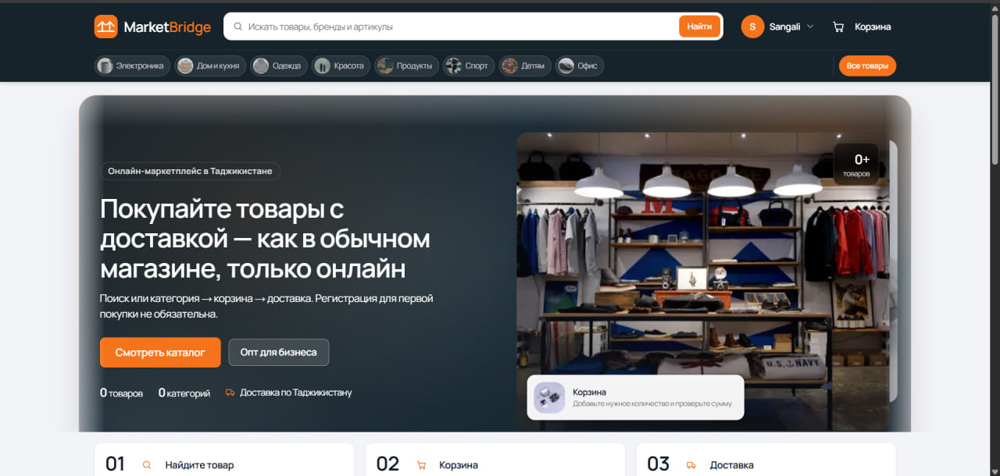

# MarketBridge — B2C/B2B маркетплейс



> 🔒 Это витрина проекта. Исходный код закрыт. Доступ к коду — по запросу: [Telegram](https://t.me/ravshanjonitolibjon) · [Email](mailto:ravg578@gmail.com)
> 🔒 This is a project showcase. Source code is private; access on request.

## 🇷🇺 О проекте

SaaS-платформа электронной торговли: один каталог и склад, но раздельные витрины и правила для обычных покупателей (B2C) и компаний (B2B). Есть кабинет продавца и админ-панель.

**Возможности**
- Единый каталог товаров и складской учёт
- B2C-витрина: корзина, оплата, заказы
- B2B-витрина: компании, индивидуальные прайсы, счета
- Кабинет продавца и админ-панель
- REST API с документацией Swagger

## 🇬🇧 About

E-commerce SaaS platform with one shared catalog and inventory but separate storefronts and business rules for consumers (B2C) and companies (B2B), plus seller and admin panels.

**Features:** shared catalog and inventory · B2C storefront (cart, payments, orders) · B2B storefront (companies, custom price lists, invoices) · seller and admin panels · documented REST API (Swagger).

## Архитектура / Architecture

```
apps/
  api/     REST API (NestJS, DDD-модули: users, catalog, inventory, pricing, orders)
  web/     Next.js: B2C (/), B2B (/b2b), seller (/seller), admin (/admin)
packages/
  shared/  общие типы
```

## Технологии / Tech stack

| | |
|---|---|
| Frontend | Next.js 15 (App Router), Tailwind CSS |
| Backend | NestJS, Prisma |
| Данные | PostgreSQL, Redis |
| Инфраструктура | Docker Compose, Railway |

---

Автор / Author: [Ravshanjon](https://github.com/Ravshanjon-developer) · © 2026. All rights reserved.
